# SmartSave — Flow Website (Mermaid)

Sumber tunggal: `SMARTSAVE_REQUIREMENT_WEBSITE_REVISI_V1_5_RAPI.docx` (versi yang sudah Anda benahi). Seluruh diagram mengikuti requirement. Prototype `.make` tidak dipakai sebagai acuan alur.

Cara membaca: kotak = halaman atau proses, belah ketupat = keputusan, kotak bulat = awal atau akhir. Label UI memakai bahasa Inggris (Bagian 19.3), keterangan memakai bahasa Indonesia. Angka bagian (misalnya "Bagian 9") merujuk ke nomor section di requirement.

| No | Diagram | Bagian requirement |
|---|---|---|
| 1 | Peta halaman dan hak akses | 2, 17 |
| 2 | Autentikasi | 12, 13, 17.1 |
| 3 | Otorisasi dan validasi di backend | 12, 13 |
| 4 | Register Food dan expiry otomatis | 3, 4, 9 |
| 5 | Pendaftaran ulang makanan | 9, 20 |
| 6 | Barcode, halaman publik, dan detail perhitungan | 5, 6 |
| 7 | Notifikasi dan tindak lanjut expiry | 10, 11 |
| 8 | Pengambilan makanan oleh User | 2.1, 17, 18 |
| 9 | Donasi dan permintaan Green Community | 10, 17.1 |
| 10 | Perhitungan CO₂e per peristiwa | 7, 18, 19 |
| 11 | Konfigurasi oleh Manager | 3, 11, 17.1 |
| 12 | Status makanan, donasi, dan permintaan | 4, 10, 17.1 |
| 13 | Dashboard, laporan, dan ekspor | 8 |
| 14 | Batas scope awal | 1, 14 |

---

## 1. Peta halaman dan hak akses (Bagian 2 dan 17)

```mermaid
flowchart TD
    G(["Guest"]) --> LAND["Landing / Home"]
    LAND --> ABOUT["About SmartSave"]
    LAND --> SIGNUP["Sign Up"]
    LAND --> SIGNIN["Sign In"]
    LAND --> PUBBC["Public Barcode Lookup"]
    PUBBC --> PUBCF["Public Carbon Footprint<br/>charts only, no personal data"]
    SIGNUP --> SIGNIN
    SIGNIN --> FORGOT["Forgot Password / Reset Password"]
    FORGOT --> SIGNIN
    SIGNIN --> ROLE{"Role?"}

    ROLE -->|User| UD["User Dashboard"]
    ROLE -->|Manager| MD["Manager Dashboard"]
    ROLE -->|Green Community| GD["Green Community Dashboard"]

    subgraph USER["Role: User"]
        UD --> U1["Register Food"]
        UD --> U2["My Food Inventory / Food Detail"]
        UD --> U3["Barcode / Print Label"]
        UD --> U4["Expiry Notifications"]
        UD --> U5["Food Donation / Donation History"]
        UD --> U6["Food Retrieval / Collection Status"]
        UD --> U7["Profile / Account Settings"]
    end

    subgraph MANAGER["Role: Manager"]
        MD --> M1["User and Role Management"]
        MD --> M2["Food & Inventory Management"]
        MD --> M3["Category & Subcategory Configuration"]
        MD --> M4["Shelf-Life Rule Configuration"]
        MD --> M5["Emission Factor Configuration"]
        MD --> M6["Barcode Management"]
        MD --> M7["Donation Management"]
        MD --> M8["Green Community Requests"]
        MD --> M9["Expiry / Website Notification Monitoring"]
        MD --> M10["Activity Logs"]
        MD --> M11["Environmental Reports"]
        MD --> M12["Profile / Settings"]
    end

    subgraph GC["Role: Green Community"]
        GD --> G1["Available Food Waste / Donations"]
        G1 --> G2["Donation Detail"]
        G2 --> G3["Submit Request"]
        GD --> G4["My Requests / Request Status"]
        GD --> G5["Received / Distributed Food History"]
        GD --> G6["Profile / Account Settings"]
    end

    SYS["Halaman sistem"] --> DENIED["Unauthorized / Access Denied"]
    SYS --> NF["Not Found"]
```

Catatan: Green Community tidak mendapat akses Manager walaupun nama tampilannya diubah dari "Food Waste Recipient" (Bagian 2.3). Halaman sistem lain yang wajib ada: state validasi form, empty, error, loading, dan success, serta navigasi responsif.

---

## 2. Autentikasi (Bagian 12, 13, 17.1)

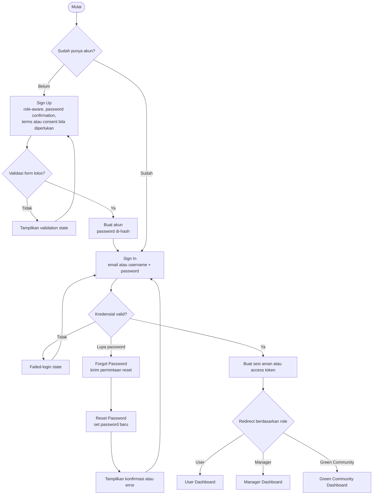

---

## 3. Otorisasi dan validasi di backend (Bagian 12 dan 13)

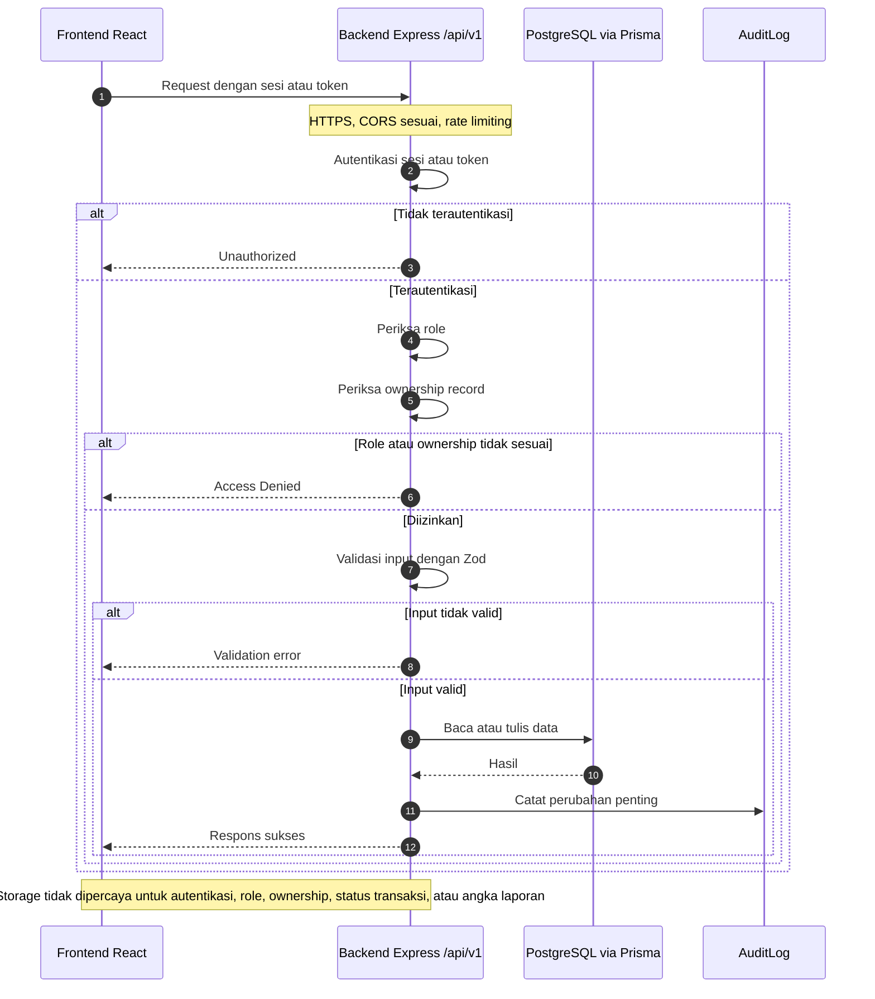

---

## 4. Register Food dan expiry otomatis — User (Bagian 3, 4, 5, 9)

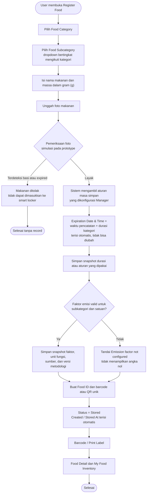

Catatan: jika kategori berubah, waktu kedaluwarsa dihitung ulang otomatis (Bagian 9 butir 4). Setelah record tersimpan, User maupun Manager tidak dapat mengubah atau memperpanjang expiry.

---

## 5. Pendaftaran ulang makanan (Bagian 9 butir 5 dan Bagian 20 butir 4)

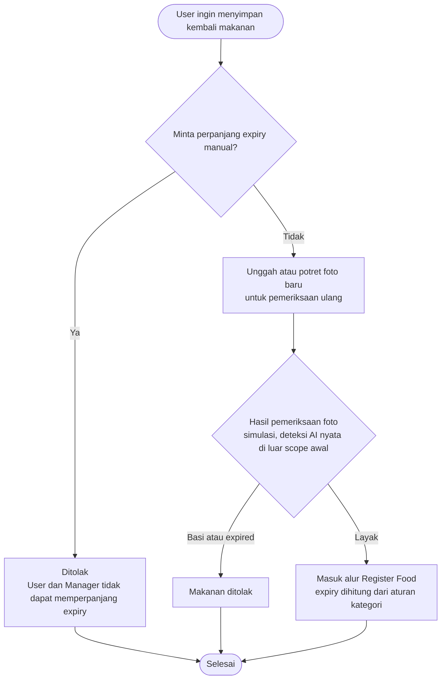

---

## 6. Barcode, halaman publik, dan detail perhitungan (Bagian 5 dan 6)

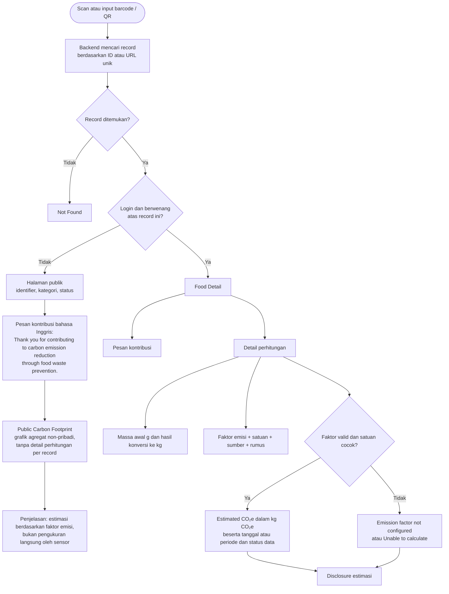

Catatan: barcode tidak boleh memuat data pribadi atau data sensitif; barcode hanya berisi ID atau URL unik. Fitur scan yang masih simulasi wajib diberi label demo, dan pemindaian kamera nyata baru boleh diklaim setelah diimplementasikan dan diuji.

---

## 7. Notifikasi dan tindak lanjut expiry (Bagian 10 dan 11)

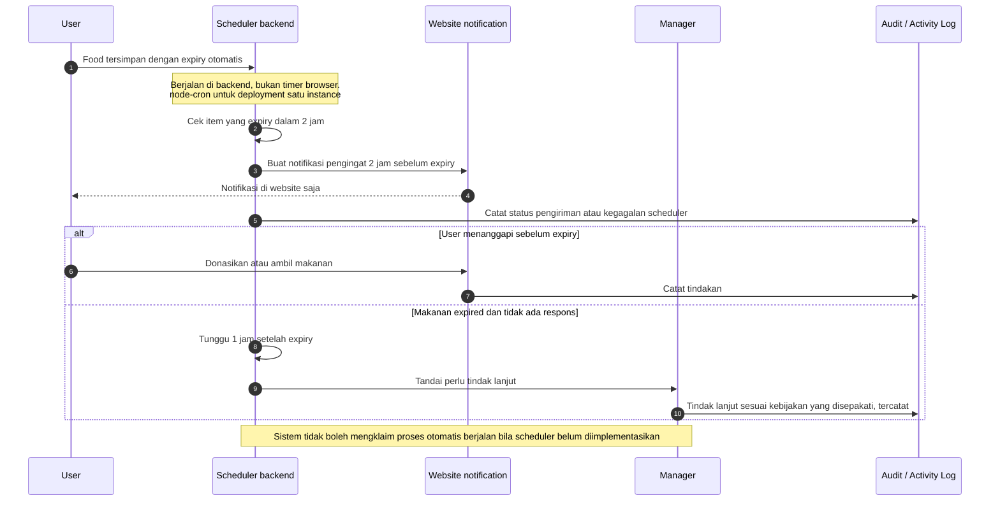

---

## 8. Pengambilan makanan oleh User (Bagian 2.1, 17, 18)

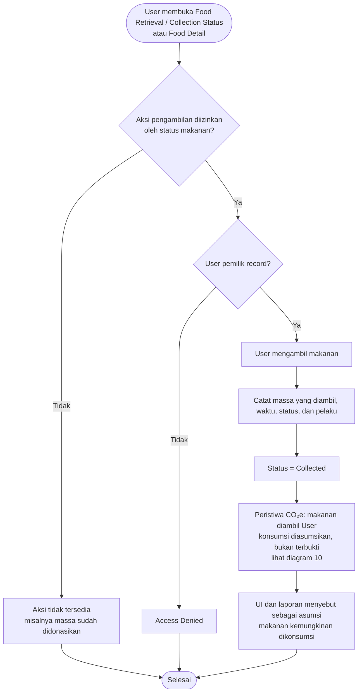

---

## 9. Donasi dan permintaan Green Community (Bagian 10 dan 17.1)

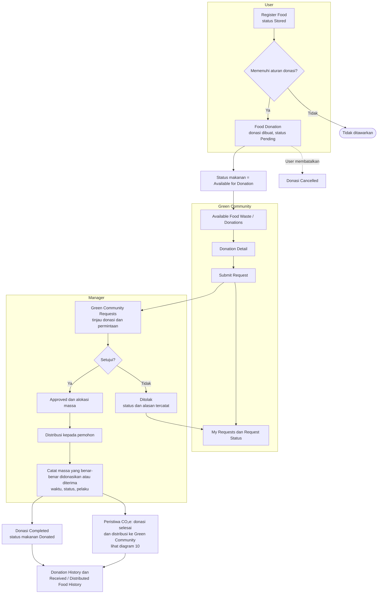

Catatan: massa yang sama tidak boleh dihitung dua kali saat berpindah tahap (Bagian 17.1, Food Donation / Donation History).

---

## 10. Perhitungan CO₂e per peristiwa (Bagian 7, 18, 19)

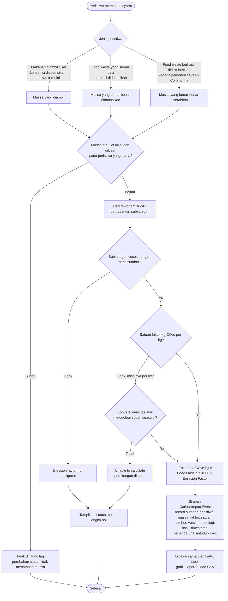

Catatan: pendaftaran makanan saja tidak berarti emisi telah dihindari; hanya peristiwa yang memenuhi syarat yang dihitung (Bagian 7). CO₂e adalah estimasi dalam kg CO₂e dan tidak boleh dipertukarkan dengan ppm sensor. Baris coklat hitam punya batas bawah negatif, jadi perlu tinjauan metodologi sebelum dipakai operasional (Bagian 19.2).

---

## 11. Konfigurasi oleh Manager (Bagian 3, 11, 17.1)

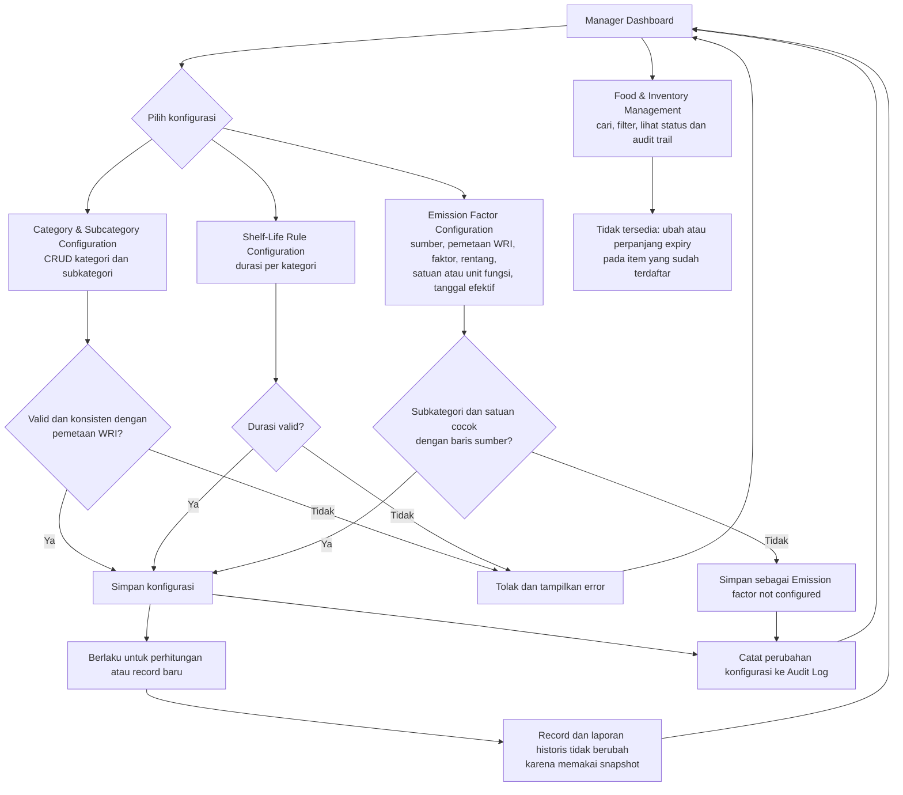

---

## 12. Status makanan, donasi, dan permintaan (Bagian 4, 10, 17.1)

Status makanan (Bagian 4). Requirement memberi contoh: Stored, Available for Donation, Donated, Collected, Expired.

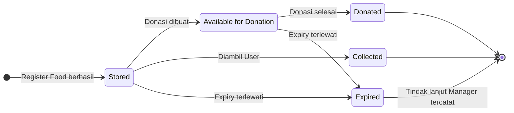

Status donasi (Bagian 17.1: completed, cancelled, atau pending):

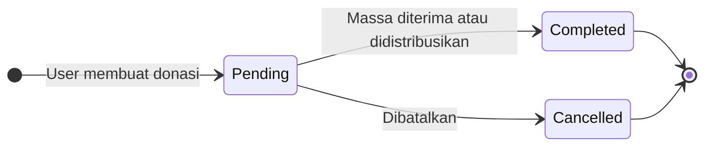

Status permintaan Green Community (Bagian 10: diajukan, ditinjau, disetujui atau ditolak, didistribusikan):

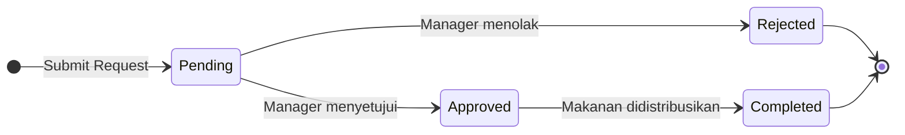

Catatan: nama status dan transisi di diagram ini adalah turunan dari teks requirement. Requirement belum mendaftar status permintaan secara resmi. Bagian 4 menyebut status makanan hanya sebagai "contoh", jadi daftar finalnya perlu Anda tetapkan sebelum implementasi.

---

## 13. Dashboard, laporan, dan ekspor (Bagian 8)

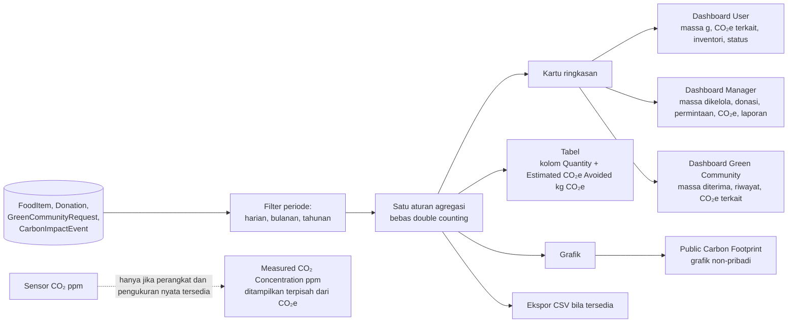

Catatan: laporan User, Donor/Donasi, dan Green Community dipertahankan terpisah. Kartu, grafik, tabel, dan CSV memakai periode serta aturan agregasi yang sama.

---

## 14. Batas scope awal (Bagian 1 dan 14)

```mermaid
flowchart LR
    subgraph IN["14.1 Termasuk scope awal"]
        I1["Website responsif desktop dan mobile"]
        I2["Registrasi, login, dan tiga role"]
        I3["Makanan, kategori, masa simpan otomatis,<br/>barcode, label, Carbon Footprint"]
        I4["Donasi, permintaan Green Community,<br/>status, riwayat, pengelolaan Manager"]
        I5["Dashboard, grafik, tabel, filter, CSV bila ada"]
        I6["Estimasi CO₂e dengan faktor yang dapat dikonfigurasi<br/>dan snapshot historis"]
        I7["Backend API, PostgreSQL, Prisma, validasi,<br/>autentikasi, otorisasi, audit log dasar"]
        I8["Scheduler backend untuk expiry dan notifikasi website"]
    end

    subgraph OUT["14.2 Tidak otomatis termasuk"]
        O1["Smart locker fisik, Raspberry Pi, kamera AI,<br/>sensor suhu dan kelembapan, alarm, sterilisasi"]
        O2["Pengukuran CO₂ ppm langsung"]
        O3["Pesan eksternal, payment gateway,<br/>layanan pihak ketiga yang belum disepakati"]
        O4["Machine learning prediksi expiry dari foto"]
        O5["Fitur yang masih simulasi sampai<br/>diimplementasikan dan diuji"]
    end

    OUT -.->|"Tidak boleh dinyatakan aktif sebelum dibangun dan diuji"| IN
```
